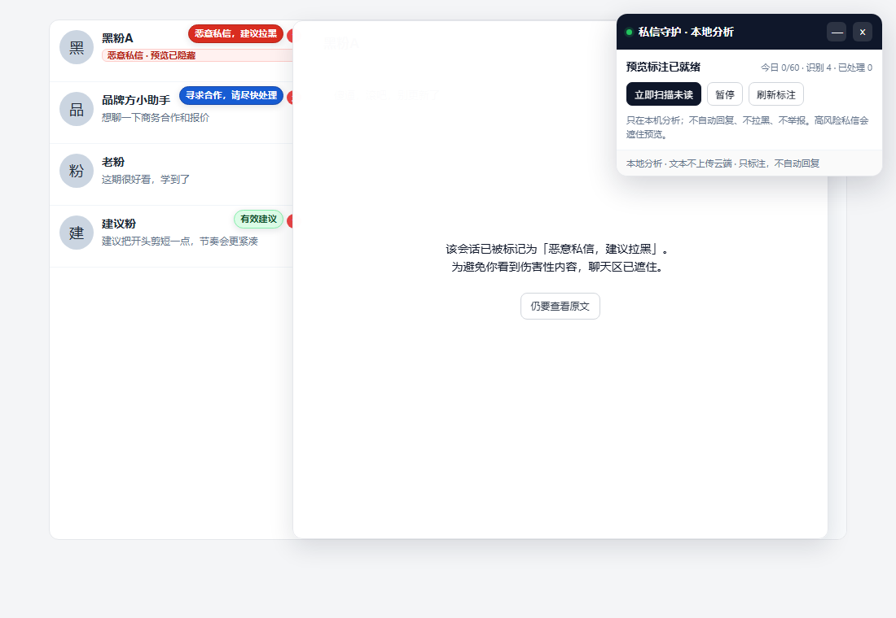
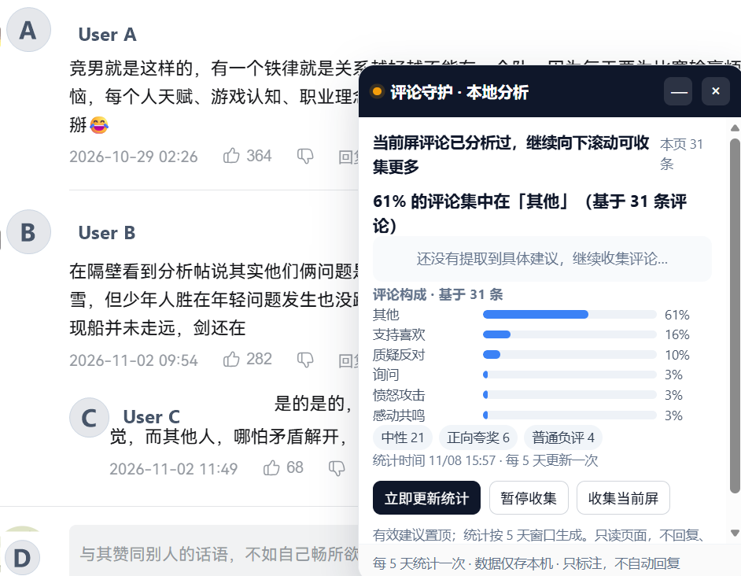

# Creator Guard · 私信评论守护

[](LICENSE)


一个**本地运行**的 B 站 / 小红书创作者助手：

- 私信列表里直接标注：`恶意私信，建议拉黑`、`涉嫌违法行为，建议截图留存`、`寻求合作，请尽快处理`、`有效建议`。
- 对恶意/违法私信，在**没点开**的列表预览上直接盖住辱骂文字，只留警告标签；如果当前打开的恰好是高风险会话，聊天区也会自动遮住，点“仍要查看原文”才显示。
- 可选：按人类节奏逐个点开未读私信，读取全文后交给本地大模型复核；读完自动切换，不回复、不拉黑、不举报。
- 评论区：自动提取“有效建议”置顶，统计每类评论占比，按 5 天窗口生成一次快照。
- 所有文本默认只存在本机 SQLite，模型也跑在本机 Ollama，不上传云端。





> 评论截图来自真实 B 站页面，但**所有用户名和头像都已替换为 `User A/B/C` 和字母头像**，不包含任何可识别身份的信息。私信截图来自 `demo/` 假页面。

> **先说清楚：封号风险不能为零。**
> 任何自动点击、自动滚动都可能被平台判定为异常行为。这个项目把风险控制在“只读、低频、单线程、不回复、不批量、不绕过验证码”，但**不提供也不建议**任何规避检测的手段（改指纹、代理轮换、验证码绕过、无头浏览器、导出 Cookie 等）。
> 最稳的用法是：先只开“预览标注 + 遮挡”，观察几天；确认没有异常，再考虑打开“自动展开”。

---

## 1. 它解决什么问题

### 私信

| 场景 | 以前 | 现在 |
|---|---|---|
| 恶意辱骂 | 必须在列表里看到前几行字，或者点开才看见 | 列表预览直接盖住，显示“恶意私信，建议拉黑” |
| 违法/敲诈/开盒 | 点开才知道，已经受到骚扰 | 预览阶段就标红，建议截图留存 |
| 商务合作 | 混在私信里容易漏 | 标蓝“寻求合作，请尽快处理” |
| 有效建议 | 要一条条翻 | 标绿“有效建议” |
| 未读太多 | 手动一个个点 | 可选自动逐个点开、读取、标注；有每日上限和强制休息 |

### 评论

| 场景 | 以前 | 现在 |
|---|---|---|
| 有效建议埋在差评里 | 往下翻很久 | 面板最上方“有效建议 Top 3” |
| 不知道整体风向 | 凭感觉 | `42% 的评论集中在「感动/共鸣」（基于 128 条评论）` |
| 统计口径变来变去 | 每次手动看 | 每 5 天生成一次快照，页面打开即显示 |
| 恶评影响心情 | 必须看到 | 恶意评论只进统计，不在面板里展示原文 |

---

## 2. 架构：四个部件，全部在本机

```text
┌─────────────────────────────────────────────────────────────┐
│ Chrome / Edge 浏览器（已登录的 B 站 / 小红书）              │
│                                                             │
│  content script（隔离世界）                                  │
│    ├─ 读取已渲染的会话列表 / 评论区 DOM                      │
│    ├─ 插入 badge、遮罩、Shadow DOM 面板                      │
│    └─ 可选：按节奏点击会话（不发送、不拉黑、不举报）          │
│                                                             │
│  background service worker                                   │
│    └─ 统一代理 HTTP 请求，避免 CORS，集中管理配置             │
└──────────────────────────┬──────────────────────────────────┘
                           │ http://127.0.0.1:8765
┌──────────────────────────▼──────────────────────────────────┐
│ FastAPI 本地服务                                             │
│  ├─ rules.py        预览快筛 / 模型不可用兜底                 │
│  ├─ classifier.py   拼 prompt、调用模型、合并规则             │
│  ├─ stats.py        5 天窗口统计、建议去重、快照               │
│  ├─ db.py           SQLite（默认保留 30 天）                  │
│  └─ app.py          API + 每小时到期统计检查                 │
└──────────────────────────┬──────────────────────────────────┘
                           │ http://127.0.0.1:11434
┌──────────────────────────▼──────────────────────────────────┐
│ Ollama + Qwen2.5-7B-Instruct（本地模型）                     │
└─────────────────────────────────────────────────────────────┘
```

### 为什么用浏览器扩展，而不是 Playwright/Selenium

- 扩展运行在**博主自己已登录的浏览器**里，不需要导出 Cookie、不需要保存密码。
- 只读页面已经渲染出来的 DOM，不碰平台接口、不逆向签名。
- 可以在**不点开私信**的情况下，先对列表预览做快筛和遮挡。
- Playwright/Selenium 需要另起浏览器、注入登录态，行为特征更明显，风险更高。

代价是：扩展的点击是 `element.click()`，属于**非受信任事件**（`isTrusted=false`）。平台理论上能检测到。所以代码里做了保守节奏、每日上限、活跃时段、单线程、每 10 条强制休息，但**不能保证不被判定自动化**。

---

## 3. 开源项目清单（可直接改）

> 许可证以各项目仓库最新 `LICENSE` 为准。下面列的是本项目实际使用或明确预留的替换点。

| 用途 | 项目 | 许可证 | 本项目用了哪部分 |
|---|---|---|---|
| 本地大模型运行时 | [Ollama](https://github.com/ollama/ollama) | MIT | 只用它的本地 HTTP API：`/api/chat`、`/api/tags`；模型管理用 `ollama pull` |
| 中文大模型 | [Qwen2.5](https://github.com/QwenLM/Qwen2.5) | Apache-2.0（7B/14B 等） | `qwen2.5:7b-instruct`，负责私信分类、评论逐条判断、建议总结 |
| 本地 API 框架 | [FastAPI](https://github.com/fastapi/fastapi) | MIT | 路由、请求校验、生命周期、后台统计任务 |
| ASGI 服务器 | [Uvicorn](https://github.com/encode/uvicorn) | BSD-3-Clause | `uvicorn server.app:app` |
| 本地数据库 | [SQLite](https://sqlite.org/) | Public Domain | 私信结果、评论、5 天快照、反馈；Python 标准库 `sqlite3` |
| 浏览器扩展 | Chrome Manifest V3 | 平台规范 | 原生 MV3，不引入打包器；`content_scripts` + `service_worker` + Shadow DOM |
| 面板 UI | 原生 Shadow DOM + CSS | 浏览器原生 | 隔离平台样式，避免面板被站点 CSS 破坏 |
| 可选：大规模评论聚类 | [BERTopic](https://github.com/MaartenGr/BERTopic) | MIT | 评论量 > 1000 时，把 LLM 的 topic 标签替换成嵌入聚类；当前版本未启用 |
| 可选：中文句向量 | [sentence-transformers](https://github.com/UKPLab/sentence-transformers) | Apache-2.0 | 配合 BERTopic 做语义聚类 |
| 可选：中文嵌入模型 | [BAAI/bge-small-zh-v1.5](https://huggingface.co/BAAI/bge-small-zh-v1.5) | MIT | 轻量中文向量，CPU 可跑 |
| 可选：OCR 兜底 | [PaddleOCR](https://github.com/PaddlePaddle/PaddleOCR) | Apache-2.0 | 仅当平台把文字画进 canvas、DOM 读不到时，对截图做 OCR；默认关闭，避免上传截图 |
| 可选：中文安全二审 | [ShieldLM](https://github.com/thu-coai/ShieldLM) | Apache-2.0（以仓库为准） | 对高风险私信做第二模型复核；默认不启用，7B 单模型已够用 |
| 可选：浏览器自动化 | [Playwright](https://github.com/microsoft/playwright) | Apache-2.0 | **本项目没有使用**。它更适合测试，不适合登录态自动化，封号风险更高 |
| 可选：定时任务 | [APScheduler](https://github.com/agronholm/apscheduler) | MIT | 本项目用 `asyncio` 内置循环代替，少一个依赖 |

### 哪些地方可以改成别的项目

- **不想装 Ollama**：把 `CG_LLM_BACKEND=mock`，只跑规则层；或者把 `server/llm.py` 的 `ollama_chat_json` 换成任何兼容 OpenAI Chat Completions 的本地服务（LM Studio、vLLM、llama.cpp server）。注意：换云端 API 就等于把私信发到云端，隐私风险自己承担。
- **想要更强的私信分类**：在 `server/prompts.py` 里加 few-shot；或在 `server/rules.py` 里加你账号常见的黑话。
- **评论量很大**：加 BERTopic + bge-small-zh，把 `stats.py` 的 `stance_counts` 换成聚类结果；UI 不用大改。
- **想换 UI**：面板是独立 Shadow DOM，改 `extension/content/common.js` 的 `createPanel` 即可，不影响抓取逻辑。

---

## 4. 目录结构

```text
creator-guard/
├─ start.bat                     # 双击启动本地服务
├─ start-mock.bat                # 不装 Ollama，只跑规则层/界面
├─ start.py                      # .bat 被智能应用控制阻止时的备用启动器
├─ .env.example                  # 复制为 .env 后改配置
├─ server/
│  ├─ app.py                     # FastAPI 入口 + 每小时统计检查
│  ├─ config.py                  # 环境变量
│  ├─ db.py                      # SQLite 表结构和读写
│  ├─ models.py                  # Pydantic 请求模型
│  ├─ rules.py                   # 规则层：辱骂/违法/合作/广告/建议
│  ├─ prompts.py                 # 所有大模型 prompt（最常改这里）
│  ├─ classifier.py              # 规则 + 模型合并
│  ├─ llm.py                     # Ollama HTTP 调用 + JSON 解析
│  ├─ stats.py                   # 5 天窗口统计、建议去重、快照
│  ├─ requirements.txt
│  └─ data/                      # 运行后生成，SQLite 在这里
├─ extension/
│  ├─ manifest.json
│  ├─ background.js              # API 代理 + 配置
│  ├─ content/
│  │  ├─ common.js               # 通用工具 + Shadow DOM 面板
│  │  ├─ selectors.js            # 平台选择器（改版时主要改这里）
│  │  ├─ dm-core.js              # 私信：预览标注、遮挡、自动展开
│  │  └─ comments-core.js        # 评论：收集、统计、面板
│  ├─ styles/overlay.css         # badge / 遮罩样式
│  ├─ popup/                     # 扩展弹窗设置
│  └─ icons/
├─ scripts/
│  ├─ smoke_test.py              # 不需要 Ollama 的接口冒烟测试
│  ├─ llm_contract_test.py       # 假 Ollama，验证 /api/chat 契约
│  └─ make_icons.py
├─ demo/                         # 假页面 + 截图，不接触真实账号
│  ├─ mock-dm.html
│  ├─ mock-comments.html
│  └─ *.png
├─ docs/
│  ├─ images/
│  │  └─ comments-panel.png       # README 截图（用户名/头像已匿名化）
│  ├─ 保姆级安装教程.md           # 从零开始，一步一步
│  ├─ 一页纸启动卡.md             # 只想马上跑起来
│  ├─ 被智能应用阻止怎么办.md      # .bat 被 Smart App Control 拦截
│  ├─ 开源项目与许可证.md
│  └─ 风险与合规.md
├─ .github/
│  ├─ workflows/ci.yml            # GitHub Actions 测试
│  └─ REPO_DESCRIPTION.md         # 仓库描述 / topics 建议
├─ CONTRIBUTING.md
├─ SECURITY.md
├─ LICENSE
└─ README.md
```

---

## 5. 快速开始

> 详细到“点哪个按钮、改哪一行”的版本看 [docs/保姆级安装教程.md](docs/保姆级安装教程.md)。
> 只想马上跑起来看 [docs/一页纸启动卡.md](docs/一页纸启动卡.md)。

### 第 0 步：获取代码

```bash
git clone https://github.com/<your-github-name>/creator-guard.git
cd creator-guard
```

或者下载仓库 ZIP 后解压，进入项目根目录。

### 第 1 步：装 Python

- 下载：<https://www.python.org/downloads/windows/>
- 安装时勾选 **Add python.exe to PATH**。
- 验证：打开 PowerShell，输入 `python --version`，应显示 3.10 或更高。

### 第 2 步：装 Ollama 和模型

- 下载：<https://ollama.com/download>
- 安装后打开 PowerShell：

```powershell
ollama pull qwen2.5:7b-instruct
```

- 验证：

```powershell
ollama run qwen2.5:7b-instruct "用一句中文回答：你准备好了吗？"
```

> 7B 大约需要 5 GB 内存/显存。低配电脑可换 `qwen2.5:1.5b-instruct`，但误判会变多。
> 如果暂时不想装模型，双击 `start-mock.bat`，只跑规则层和界面，先把扩展跑通。
>
> **模型名不一致时**：如果你的 `ollama list` 显示的是 `qwen2.5:7B` 而不是 `qwen2.5:7b-instruct`，复制 `.env.example` 为 `.env`，把 `CG_OLLAMA_MODEL` 改成 `ollama list` 里的同名模型。`.env` 是本地配置，不会提交到 Git。

### 第 3 步：启动本地服务

- 双击项目根目录的 `start.bat`。
- 第一次会自动创建 `.venv` 并安装依赖。
- 看到 `Uvicorn running on http://127.0.0.1:8765` 即成功。
- 浏览器会自动打开状态页；也可以手动访问 <http://127.0.0.1:8765/api/health>。
- 想看接口文档：<http://127.0.0.1:8765/docs>。

> **如果双击 `start.bat` 被 Windows“智能应用控制”阻止**（没有“仍要运行”按钮）：
> 不要反复双击，也不建议直接关掉智能应用控制。改用 PowerShell：
>
> ```powershell
> cd C:\CreatorGuard
> py -3 start.py
> ```
>
> 或者先试：
>
> ```powershell
> cmd /c start.bat
> ```
>
> 详细排查见 [保姆级安装教程](docs/保姆级安装教程.md) 第 5.4 节，或直接看 [被智能应用阻止怎么办](docs/被智能应用阻止怎么办.md)。

**macOS / Linux** 没有 `start.bat`，直接用：

```bash
python3 start.py
```

它会创建 `.venv`、安装依赖并启动同一个本地服务。

### 第 4 步：加载扩展

1. Chrome/Edge 地址栏输入 `chrome://extensions`（Edge 是 `edge://extensions`）。
2. 打开右上角 **开发者模式**。
3. 点 **加载已解压的扩展程序**。
4. 选择项目里的 `extension` 文件夹（**不是**项目根目录）。
5. 把 Creator Guard 固定到工具栏。

### 第 5 步：配置

点扩展图标：

- 本地服务地址：`http://127.0.0.1:8765`
- 点 **测试连接**，应显示“本地服务 + 模型已就绪”。
- 先保持：
  - 自动展开未读私信：**关**
  - 自动滚动收集评论：**关**
  - 遮住恶意私信预览：**开**
  - 高风险私信不展开：**开**

### 第 6 步：试私信

1. 打开 <https://message.bilibili.com/>。
2. 等 3 秒，右上角出现“私信守护”面板。
3. 列表里的恶意/合作/建议私信会出现 badge；恶意/违法预览会被盖住。
4. 想只分析当前屏，点 **刷新标注**。
5. 确认没有异常后，再考虑在扩展弹窗里打开“自动展开未读私信”。

### 第 7 步：试评论

1. 打开任意 B 站视频（有评论的）。
2. 右下角出现“评论守护”面板。
3. 点 **收集当前屏**，再点 **立即更新统计**。
4. 面板顶部应出现“有效建议”和占比。
5. 想自动往下翻，再打开“自动滚动收集评论”。

---

## 6. 关键设计说明

### 6.1 为什么先做“预览快筛”，再点开全文

列表预览只有一两行，信息不完整，但足够抓明显辱骂/违法/合作词。流程是：

1. 页面加载 → 读取所有可见会话预览 → `POST /api/dm/preview` → 规则层 1 秒内返回。
2. 恶意/违法 → 立刻在预览上盖遮罩，不等点开。
3. 如果开启自动展开 → 逐个点开 → 读取全文 → `POST /api/dm/classify` → 模型复核 → 更新 badge。
4. 已经分析过的会话，下次打开页面直接读 SQLite 缓存，不再点开。

这样即使不开自动展开，也能获得大部分保护。

### 6.2 停留时长怎么算

在 `extension/content/dm-core.js`：

```js
CG.humanReadingDelay = (textLength) => {
  const base = 1400 + Math.min(textLength * 38, 6000);
  return Math.round(base * (0.8 + Math.random() * 0.5));
};
```

- 1 个字约 38ms，最长 6 秒。
- 再乘 0.8–1.3 的随机抖动。
- 两条会话之间再等 3.2–7.8 秒。
- 每 10 条强制休息 2.5–4 分钟。
- 默认每日最多 60 条、单次最多 20 条。

这些参数都在 `dm-core.js` 和扩展弹窗里，可以自己调慢，**不建议调快**。

### 6.3 5 天统计怎么实现

- 每条评论入库时带 `created_at`。
- `GET /api/comments/stats` 先看 `thread_stats` 最新快照：
  - 快照 < 5 天：直接返回快照，附带“新增 N 条待下次统计”。
  - 快照 ≥ 5 天或没有快照：重新计算并写入新快照。
- **5 天是“刷新频率”，不是“只统计最近 5 天”。** 快照会包含该视频下已经收集到的全部评论，避免旧评论被悄悄从分母里删掉。
- 后台每小时检查一次到期评论区（`CG_AUTO_STATS=true`）。
- 面板上的“立即更新统计”会强制刷新，用于调试。

占比不是模型编的，是后端用 `Counter` 算的：

```python
pct = round(count / total * 100)
```

模型只负责给每条评论打 `stance` 标签，以及把“有效建议”合并成一段话。

### 6.4 为什么只标注，不自动拉黑/举报/回复

- 自动拉黑/举报/回复会改变账号状态，误判成本高，且更像机器人。
- 代码里没有任何 `send`、`block`、`report` 的调用。
- 面板只给“建议”，最终由人点按钮。
- 这样即使模型误判，也不会造成不可逆后果。

---

## 7. 已知限制

1. **平台改版会导致选择器失效**。`extension/content/selectors.js` 里是多组候选；如果完全识别不到，按教程用 DevTools 加一条。
2. **`element.click()` 是非受信任事件**。平台理论上能检测；本项目的节奏控制只能降低概率，不能消除。
3. **点开私信会变成已读**。这是平台行为，扩展无法既读全文又保持未读。
4. **模型会误判**。规则层和 prompt 都按“宁可漏判，不要误伤”设计；高风险场景建议人工复核。
5. **小红书 DOM 变动比 B 站更频繁**。首次使用可能需要校准选择器。
6. **不处理图片/语音/视频私信**。当前只读文字 DOM；图片文字需要 OCR，默认没开。
7. **不绕过验证码/风控页**。检测到验证页时，代码不会继续点击；需要人工处理。
8. **B站新版评论区使用 Web Components + open Shadow DOM**。`comments-core.js` 已经递归穿透 `<bili-comments>` 的 shadow root；如果 B 站以后改组件名，需要更新 `collectBiliComments` 里的选择器。

---

## 8. 隐私与数据

- 服务只监听 `127.0.0.1`，扩展也只允许连本机地址。
- 默认模型在本机 Ollama，私信文本不出电脑。
- SQLite 文件：`server/data/creator_guard.db`。
- 默认保留 30 天，启动时清理过期数据。
- 清空数据：

```powershell
# 先关掉 start.bat，再删文件
Remove-Item server\data\creator_guard.db
```

或者服务运行时：

```powershell
Invoke-RestMethod -Method Delete "http://127.0.0.1:8765/api/data?confirm=DELETE"
```

- 不要把 `server/data/`、`.env`、数据库文件发给别人。

---

## 9. 跑测试

不需要 Ollama：

```powershell
.\.venv\Scripts\python.exe scripts\smoke_test.py
```

会验证：

- 健康检查
- 私信预览快筛
- 违法私信分类
- 缓存标注
- 评论批量分类
- 5 天统计
- 反馈入库

再跑一个不依赖真 Ollama 的模型 HTTP 契约测试：

```powershell
.\.venv\Scripts\python.exe scripts\llm_contract_test.py
```

它会在本机随机端口起一个假 Ollama，验证 `/api/chat` 的请求格式、JSON 解析、模型结果与规则层合并。

---

## 10. 下一步可以怎么改

- 把 `server/prompts.py` 改成你账号的“黑话词典”和 few-shot。
- 给 `rules.py` 加你遇到过的辱骂变体、合作话术。
- 评论量 > 1000 时接 BERTopic + bge-small-zh，把 `stance` 聚类成更细的“观众观点”。
- 把 5 天快照导出成 CSV，做长期趋势。
- 加一个“人工纠错”按钮，把 `POST /api/feedback` 接上，用反馈微调规则/prompt。

---

## 10.5 FAQ

### Q：`ollama list` 里是 `qwen2.5:7B`，但程序说找不到 `qwen2.5:7b-instruct`

不用重新下载。把项目根目录 `.env` 里的：

```text
CG_OLLAMA_MODEL=qwen2.5:7b-instruct
```

改成 `ollama list` 里显示的一模一样的名字，例如：

```text
CG_OLLAMA_MODEL=qwen2.5:7B
```

保存后重启 `start.py` / `start.bat`，刷新 `/api/health`，看到 `"model_present": true` 即可。

### Q：B 站评论区点“收集当前屏”没反应

B 站新版评论区是 `<bili-comments>` Web Components，评论在 open Shadow DOM 里。当前版本已做穿透，但请确认：

1. 已重新加载扩展（`chrome://extensions` / `edge://extensions` → 重新加载）。
2. 网页版 B 站已登录，评论区能看到具体评论。
3. 已滚动到评论列表，等 2–3 秒。
4. 点“收集当前屏”后，面板应显示“正在分析 N 条评论…”或“当前屏评论已分析过…”。

如果 Console 里是 `[CreatorGuard] comments: found=0`，把 B 站页面 DOM 截图发 Issue。

### Q：小红书 `/im` 一直转圈

这是小红书网页版自己的加载/登录/账号权限问题，不是扩展能修的。先打开小红书首页登录，再点消息入口；如果仍然转圈，说明该账号暂时没有网页版私信，只能使用小红书 App。扩展只能读取浏览器中已经加载出来的页面。

### Q：扩展弹窗切到别的窗口就消失了

Chrome/Edge 的扩展弹窗失去焦点会自动关闭，这是浏览器行为。重新点工具栏图标即可。想让它一直开着，可以在新标签页打开：

```text
chrome-extension://<你的扩展ID>/popup/popup.html
```

### Q：双击 `start.bat` 被 Windows 智能应用控制阻止

用 `cmd /c start.bat`，或者直接：

```powershell
py -3 start.py
```

详见 [被智能应用阻止怎么办](docs/被智能应用阻止怎么办.md)。

---

## 11. 许可证

本项目代码 MIT。第三方项目各自遵循其许可证；商用/分发前请逐个确认，尤其是模型许可证（Qwen2.5 7B 是 Apache-2.0，但不同尺寸/版本可能不同）。

---

## 12. 一句话总结

**先用“预览标注 + 遮挡”零点击运行；确认安全后，再开“自动展开 + 自动滚动”；永远不要加自动回复、自动拉黑、自动举报。**
